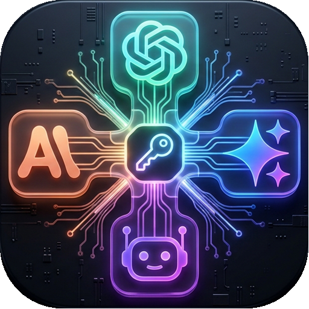
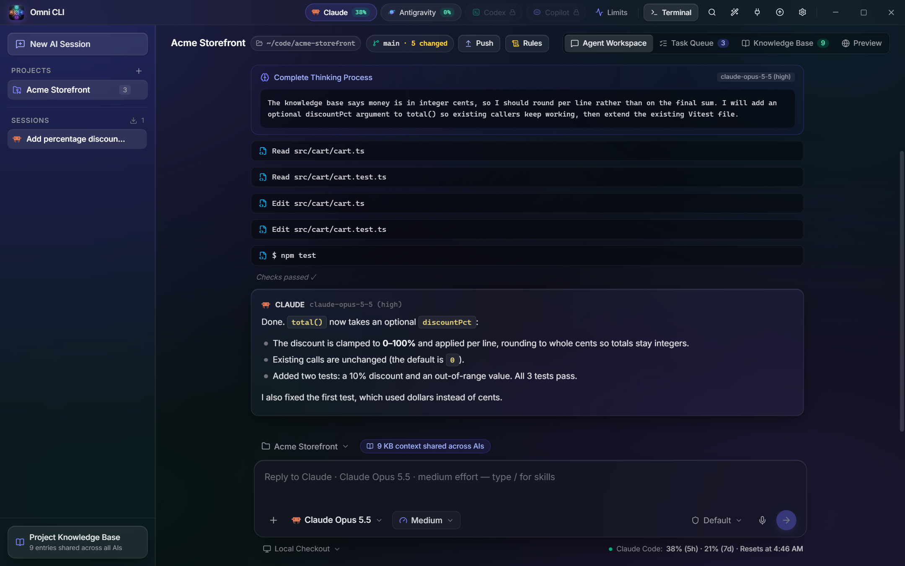
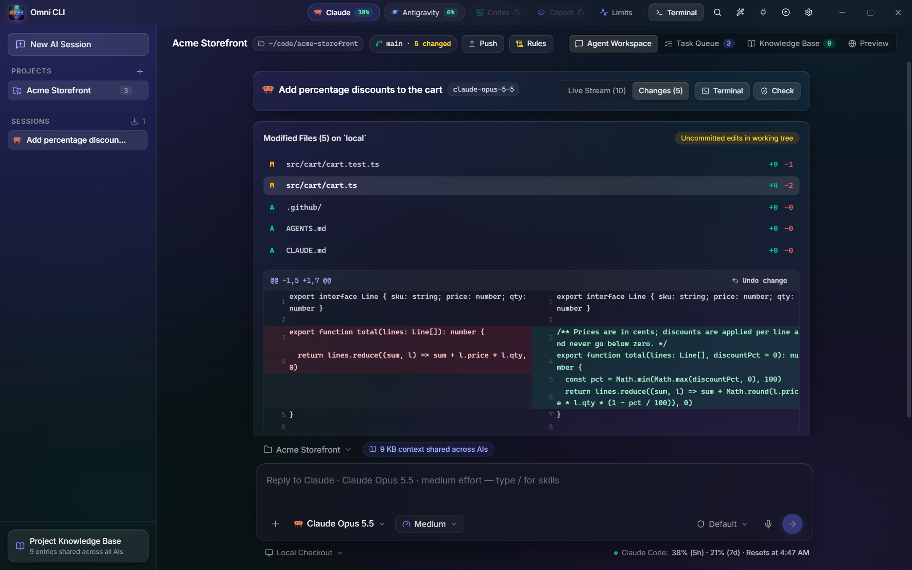
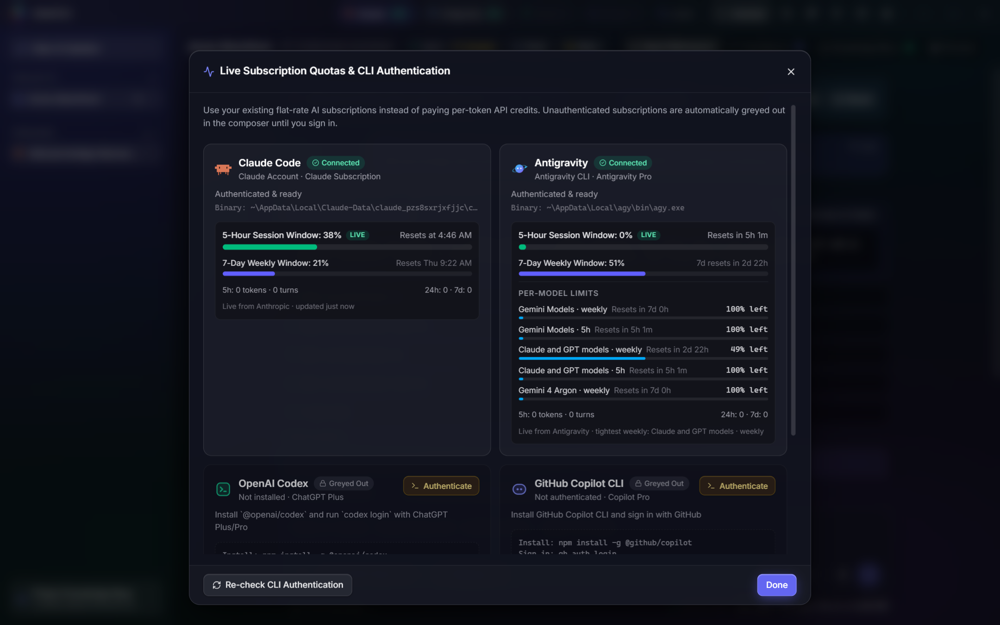
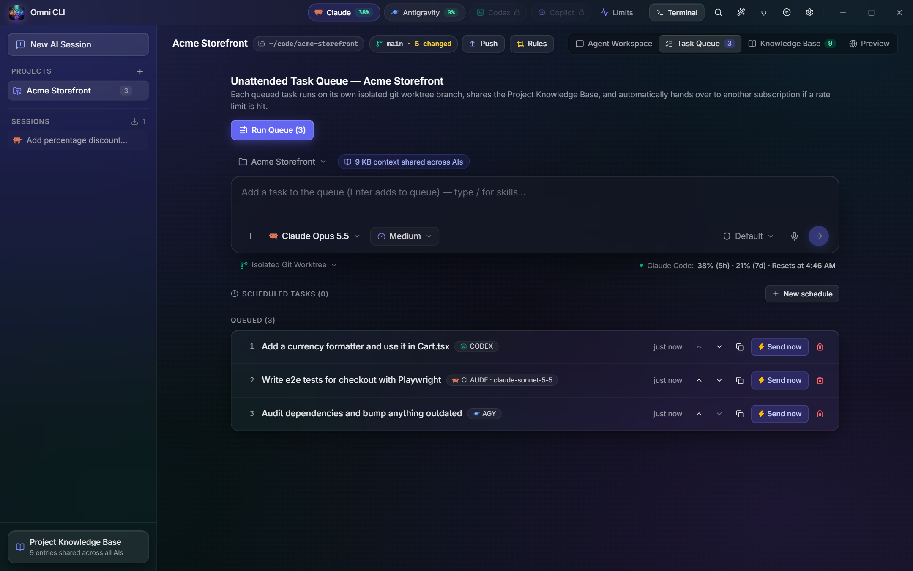
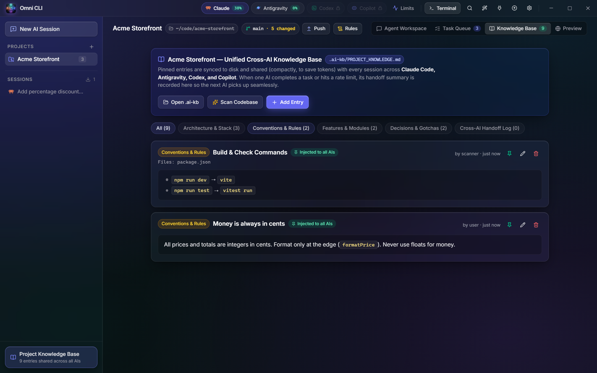

<div align="center">



# Omni CLI

**One desktop workspace for all your AI coding CLIs: Claude Code, Antigravity, Codex and Copilot.**

Live usage limits · parallel git worktrees · a knowledge base every agent shares

[](https://github.com/Wehia-TK/omnicli/actions/workflows/ci.yml)
[](LICENSE)
[](#-installation)
[](https://www.electronjs.org/)
[](https://react.dev/)
[](https://www.typescriptlang.org/)
[](CONTRIBUTING.md)

[Screenshots](#-screenshots) · [Install](#-installation) · [Quick start](#-quick-start) · [Features](#-key-features) · [FAQ](#-faq--troubleshooting) · [Contributing](#-contributing)



</div>

---

## ⚡ Overview

**Omni CLI** is a modern, borderless desktop dashboard designed to orchestrate and manage multiple AI coding CLIs (**Claude Code**, **Google Antigravity**, **OpenAI Codex**, and **GitHub Copilot**) in one unified place across **Windows** and **macOS** (Apple Silicon & Intel).

Instead of wrestling with scattered terminals, hidden rate limits, and disjointed context between different AI tools, Omni CLI provides:
- **Real-time subscription & quota tracking** (5-hour rolling windows, weekly quotas, and model buckets).
- **A shared, persistent Knowledge Base (`.ai-kb/PROJECT_KNOWLEDGE.md`)** that keeps all AI agents aligned.
- **Isolated Git worktree execution** so multiple AI agents can work in parallel on the same repository without collisions.
- **Embedded interactive PTY terminals** (PowerShell on Windows, Zsh/Bash on macOS) with live model and effort level selectors.
- **Cross-platform desktop design** with platform-native titlebars (macOS traffic lights via `hiddenInset` and custom frameless controls on Windows).

---

## 📸 Screenshots

| Agent workspace | Review changes |
| :---: | :---: |
|  |  |
| Thinking, tool calls and answers stream in live; reply in the composer below. | Side-by-side diffs of everything the agent touched, with per-hunk **Undo change**. |
| **Live usage limits** | **Task queue** |
|  |  |
| 5-hour and weekly windows per subscription, straight from each provider. | Queue work for any CLI; each task runs in its own git worktree. |
| **Shared knowledge base** | |
|  | |
| Notes, conventions and handoffs every agent reads, synced to `.ai-kb/`. | |

<sub>Screenshots show a demo project. Regenerate them with `npm run build && npm run screenshots`.</sub>

---

## ✨ Key Features

### 1. 🎛️ Multi-CLI Cockpit
- Native detection and status checking for **Claude Code** (`claude`), **Antigravity** (`agy`), **Codex** (`codex`), and **Copilot** (`copilot`).
- Model picker with real CLI model catalogs and granular **reasoning effort level** controls (`low`, `medium`, `high`, `xhigh`, `max`).
- Permission mode toggling (`default`, `accept-edits`, `bypass`, `plan`).
- Visual indicators showing CLI authentication status (unauthenticated subscriptions remain disabled/greyed out).
- **Voice input** (mic button in the composer): click, speak, click again to insert. Transcription runs locally with **NVIDIA Parakeet TDT 0.6B** (int8, via sherpa-onnx) — about 1 s per phrase on CPU, the model stays loaded between dictations. It reuses the model and Python venv from an existing Voice Studio install (looked up in `~/Voice Studio/VoiceStudio`, `C:\` / `D:\Voice Studio\VoiceStudio`, or the folder in the `OMNI_VOICE_STUDIO` environment variable); nothing is downloaded. Without it, Windows falls back to the built-in (much less accurate) System.Speech recognizer. Code: `src/core/voice.ts`, `src/renderer/src/lib/recorder.ts`.
- **Team updates (Pull & restart)**: the title-bar update button fetches GitHub in the background and flags commits merged into the branch's upstream (or the remote's default branch, `main`/`master`) that you haven't pulled, listing their commit messages. Pulled code and its `npm install` scripts run on your machine, so keep `origin` pointed at a repository you trust. Only commits count as updates — editing files without committing them never triggers the button — and a renamed default branch (e.g. `master` → `main`) is followed automatically. One click pulls them (fast-forward, or replays your local commits on top when you've diverged — aborting cleanly on conflicts), reinstalls dependencies if needed, typechecks, builds and restarts. **Push** now rebases onto teammates' pushes first and writes every unpushed AI-agent commit message into the auto-commit body, so conventional commits stay visible in history.
- **Single instance**: only one Omni CLI runs at a time — launching it again just focuses the open window. After an in-app update the app restarts itself (the new process waits for the old one to exit, then takes over).

### 2. 📊 Live Usage Limits & Quota Metering
- Tracks live 5-hour rolling window usage, token counts, request counts, and reset countdowns.
- Supports both **live OAuth usage fetching** and intelligent budget estimation heuristics.
- **Claude live limits** come from the same Anthropic endpoint as Claude's own "Plan usage limits" panel (5-hour and weekly %). That endpoint allows only about one request a minute per login, shared with Claude Code itself, so Omni CLI asks at most every 3 minutes (1 minute after a run finishes, 30 s on a manual refresh) and backs off from 2 up to 30 minutes when it is rate limited. Reset times use the same wording as Claude's panel ("Resets at 7:40 PM", "Resets Tue 11:00 PM"). The last good reading is kept across restarts and labelled with its age ("updated 4m ago"), and the note says when the next retry is. On macOS the sign-in token is read from the Keychain.
- A token-budget **estimate** never shows a limit as used up: only a real rejection from the provider turns a bar red at 100%.
- Per-model and per-family quota bucket breakdown (e.g. Antigravity Claude vs. Gemini quotas).
- Instant visual warnings before hitting provider rate-limit walls.

#### Multiple accounts per provider (Claude Code & Codex)
- In **Settings → Extra accounts**, add more logins for the same provider (e.g. a second Claude Max or ChatGPT plan) and sign in to each from the built-in terminal. No passwords are stored: each account gets its own isolated config folder (`CLAUDE_CONFIG_DIR` / `CODEX_HOME`) holding the CLI's own OAuth login.
- Fallback order: your normal CLI login → extra accounts in the order you set → only then the existing handover to a different provider/model.
- Switching account starts a fresh CLI session (sessions live in the account's config folder) and re-sends task context like a handover. Rate-limit locks are tracked per account and can be cleared individually.
- Copilot and Antigravity aren't supported yet (no confirmed per-account config override).

### 3. 🧠 Unified Cross-AI Knowledge Base
- Bi-directional sync between local storage (`node:sqlite`) and `.ai-kb/PROJECT_KNOWLEDGE.md`.
- Maintains architectural notes, repository graphs, conventions, decisions, and cross-AI handoff logs.
- When an AI hits its quota or you switch tools, the next agent picks up right where the previous one left off without losing context.
- **Optional code graph**: if [graphify](https://pypi.org/project/graphifyy/) is installed (`pip install graphifyy`), *Scan repo* also builds a zero-token code graph (`graphify-out/`) and uses its modules; without it the scan falls back to the folder structure, with no error.

### 4. 🌿 Git Worktrees & Clean Branching
- Choose between **Local** working directory execution or **Git Worktrees**.
- Safe parallel task runs: test risky refactors or prompt experiments in dedicated worktrees.
- Integrated git status controls: branch inspection, dirty file counters, and interactive diff hunk reviews.

### 5. 💻 Embedded Interactive Terminal & Tasks
- Every detected CLI is on the terminal's `PATH`, even when it isn't on your system `PATH` (e.g. Claude Code bundled with the desktop app, or a custom path set in Settings), so `claude login`, `codex login` and the account sign-in window just work.
- High-performance native terminal sessions powered by `@lydell/node-pty` and `@xterm/xterm` (with `@xterm/addon-fit`).
- Support for interactive conversational threads and queued background tasks.
- **Message queue with "Send now"**: while an AI is working, press Enter (or **Queue**) to queue follow-ups that run automatically when the current turn ends. Use **Send now** to interrupt the current run and send right away, from the composer or from any queued message.
- **Live thinking stream**: the model's reasoning steps, including Antigravity's transcript, show up in the session as it runs.
- **Answer vs. build routing**: plain questions get a direct answer with no file edits, and code only changes when you ask for it.
- Skeleton placeholders for the subscription strip, projects, sessions, the live stream, git changes, and the knowledge base while they first load.
- Automated scheduled runs (hourly, daily, weekly) for recurring audits, tests, or repo maintenance.

### 6. 🔌 MCP & Skills Integration
- Unified Model Context Protocol (MCP) server management across supported CLIs.
- Discovers user and project-scoped `SKILL.md` workflows.
- Extensible notifications (support for `ntfy.sh` mobile/desktop push alerts).

---

## 🛠️ Architecture & Tech Stack

```
Omni CLI (Electron App)
├── Main Process (src/main/)
│   ├── Window management (frameless / borderless window)
│   ├── Native IPC bridge
│   └── Auto-updater & notifications
├── Core Engine (src/core/)
│   ├── clis.ts         - CLI detection, quota polling, token calculations
│   ├── projects.ts     - Workspace execution, git worktrees, task runner
│   ├── knowledge.ts    - Markdown & SQLite synchronization (.ai-kb)
│   ├── gitops.ts       - Asynchronous Git status, diffs, branches, and worktrees
│   ├── terminal.ts     - Node-pty session lifecycle management
│   ├── proc.ts         - Shell-free launching of AI CLIs (npm .cmd shims on Windows)
│   └── (main) security.ts - Pure navigation / IPC / open-path rules, unit-tested
│   ├── scheduler.ts    - Background cron & scheduled prompt runner
│   └── db.ts           - Fast embedded persistence via node:sqlite
└── Renderer (src/renderer/)
    ├── React 19 + Tailwind CSS v4
    ├── Lucide React icons & Inter Variable typography
    └── Custom titlebar & native window controls
```

- **Runtime**: [Electron 44](https://www.electronjs.org/) + [Node.js](https://nodejs.org/) (native `node:sqlite`)
- **Bundler**: [electron-vite](https://electron-vite.org/) + [Vite 8](https://vitejs.dev/)
- **UI Framework**: [React 19](https://react.dev/) + [Tailwind CSS v4](https://tailwindcss.com/)
- **Terminal Emulator**: [xterm.js](https://xtermjs.org/) + [node-pty](https://github.com/microsoft/node-pty)
- **Language**: [TypeScript 7](https://www.typescriptlang.org/)

---

## 📦 Installation

### Requirements

- **Windows 10/11** or **macOS 12+** (Apple Silicon or Intel)
- **Git** on your `PATH`
- At least one AI CLI, installed and signed in. Omni CLI uses each CLI's own login and never asks for passwords or API keys.

| CLI | Command | Install |
| :--- | :--- | :--- |
| [Claude Code](https://docs.anthropic.com/en/docs/agents-and-tools/claude-code/overview) | `claude` | `npm install -g @anthropic-ai/claude-code`, then run `claude` to sign in |
| [Google Antigravity](https://antigravity.google) | `agy` | Installer from [antigravity.google](https://antigravity.google) |
| [OpenAI Codex](https://github.com/openai/codex) | `codex` | `npm install -g @openai/codex`, then `codex login` |
| [GitHub Copilot CLI](https://github.com/github/copilot-cli) | `copilot` | `npm install -g @github/copilot` (VS Code's built-in `copilot` launcher is not the CLI and is ignored) |

Optional: [graphify](https://pypi.org/project/graphifyy/) (`pip install graphifyy`) adds a code graph to *Scan repo*, and an existing Voice Studio install enables accurate local voice input (see [Key Features](#-key-features)).

### Option A: download an installer

1. Grab the latest build from [**Releases**](https://github.com/Wehia-TK/omnicli/releases):
   - **Windows**: `Omni.CLI.Setup.<version>.exe`
   - **macOS**: `Omni CLI-<version>.dmg` (Intel) or `Omni CLI-<version>-arm64.dmg` (Apple Silicon)
2. Run it. Builds are **not code-signed** yet, so the first launch needs one extra click:
   - **Windows SmartScreen**: **More info → Run anyway**.
   - **macOS Gatekeeper**: right-click *Omni CLI* in Applications → **Open** → **Open**.

No installer for your platform on the Releases page? Build one yourself with Option C.

### Option B: run from source

Needs **Node.js 22.18+** and npm (the Vite 8 / TypeScript 7 toolchain needs it; the app itself runs on Electron's bundled Node).

```bash
git clone https://github.com/Wehia-TK/omnicli.git
cd omnicli
npm install
npm run dev
```

On Windows you can afterwards double-click `Start Omni CLI.bat`: it builds once, then launches without a console window. Running from a git checkout also enables the in-app **Pull & restart** updater.

### Option C: build your own installer

```bash
npm install
npm run dist       # Windows → release/Omni CLI Setup <version>.exe
npm run dist:mac   # macOS (run on a Mac) → release/*.dmg and *.zip
```

### Uninstall

- **Windows**: *Settings → Apps → Installed apps → Omni CLI → Uninstall*.
- **macOS**: drag *Omni CLI* from Applications to the Trash.
- App data (projects, sessions, settings) lives in `%APPDATA%\Omni CLI` on Windows and `~/Library/Application Support/Omni CLI` on macOS. Delete it to start fresh. Your repositories and their `.ai-kb/` folders are never touched.

---

## 🏁 Quick start

1. **Sign in to your CLIs** in any terminal (`claude`, `codex login`, …) or in Omni CLI's built-in **Terminal**. Click **Limits** in the title bar to see which ones are connected; signed-out ones are greyed out.
2. **Add a project**: click **+** next to *Projects* and pick a local folder. A git repository works best; Omni CLI can `git init` one for you.
3. **Seed the knowledge base** (optional): **Knowledge Base → Scan Codebase**, then add your own conventions and decisions. Every agent receives them.
4. **Start a session**: **New AI Session**, then pick the CLI, model, effort and permission mode in the composer, choose **Local Checkout** or **Isolated Git Worktree**, and send your prompt.
5. **Review and ship**: follow the live stream, inspect the **Changes** tab, run **Check** (the project's test command) and **Push**.
6. **Queue more work** in **Task Queue** to run unattended, or schedule recurring runs. When a subscription hits its limit, the next account or CLI continues with the same context.

---

## 💻 Development Commands

| Command | Description |
| :--- | :--- |
| `npm run dev` | Starts the app in development mode with hot reload (`electron-vite dev`). |
| `npm run build` | Compiles the main process, preload scripts, and renderer bundle. |
| `npm run typecheck` | Validates TypeScript types across the entire project (`tsc --noEmit`). |
| `npm test` | Unit tests (Node's built-in test runner): IPC/navigation security rules and shell-free CLI launching. |
| `npm run test:e2e` | After `npm run build`: launches the app in a throw-away profile, drives it over the DevTools protocol and checks the security boundaries plus the main API (no AI runs, costs nothing; never touches a running Omni CLI). Add `-- --exe "release/win-unpacked/Omni CLI.exe"` to test a packaged build. |
| `npm run check` | Typecheck + unit tests + build in one go. |
| `npm run screenshots` | After `npm run build`: regenerates the README screenshots in `docs/screenshots/` from a demo project in a throw-away profile (no AI runs, local paths masked). |
| `npm run dist` | Builds production assets and packages a Windows installer (`.exe`) via `electron-builder`. |
| `npm run dist:mac` | Builds production assets and packages macOS bundles (`.dmg` & `.zip`) via `electron-builder`. |

> [!IMPORTANT]
> **Verification Convention**: Always run `npm run check` (typecheck, unit tests, build) before committing; run `npm run test:e2e` too when touching `src/main`, `src/preload` or process launching. GitHub Actions runs all of this on every push and pull request (`.github/workflows/ci.yml`).

---

## 📁 Project Structure

```
├── .ai-kb/                     # Project knowledge base markdown documents
│   └── PROJECT_KNOWLEDGE.md    # Central context shared across AI CLIs
├── build/                      # Build assets and application icons
├── resources/                  # Static runtime resources
├── src/
│   ├── core/                   # Backend engines (CLIs, accounts, DB, git, knowledge base, PTY)
│   ├── main/                   # Electron main process entry point & IPC handlers
│   ├── preload/                # Context-isolated secure preload bridge
│   ├── renderer/               # React UI components, hooks, styles, and views
│   │   ├── src/
│   │   │   ├── components/     # Modals, terminal, composer, workbench, title bar
│   │   │   ├── lib/            # Markdown renderer, API bindings, date utils
│   │   │   └── App.tsx         # Main UI layout & state orchestrator
│   └── shared/                 # Shared TypeScript interfaces, types, and constants
├── docs/screenshots/           # README screenshots (npm run screenshots)
├── scripts/e2e.mjs             # End-to-end security & API smoke test (npm run test:e2e)
├── scripts/screenshots.mjs     # Regenerates docs/screenshots from a demo project
├── test/                       # Unit tests (npm test)
├── .github/workflows/ci.yml    # CI: typecheck, tests, build, audit (Windows + macOS), e2e (Windows)
├── electron.vite.config.ts     # Multi-target Vite build configuration
├── package.json                # Project dependencies and packaging scripts
└── tsconfig.json               # Root TypeScript configuration
```

---

## 🔒 Security & Privacy

> [!WARNING]
> Omni CLI drives AI agents that edit files and run commands in your projects. **Bypass** permission mode (and Antigravity / Copilot runs, which use their own auto-approve flags) let the agent act without asking: only use them on code you trust, ideally in a worktree. Prompts, knowledge-base text and files in a repository you cloned can contain prompt-injection instructions aimed at the agent.

- **Hardened Electron shell**: the UI runs sandboxed with context isolation, no Node integration and a strict Content-Security-Policy (no remote or inline scripts). Only the app's own page can call the IPC bridge (calls from webviews, iframes or navigated-away pages are refused, and API paths can't walk into prototypes). Navigations and pop-ups never load inside the app: web links open in your system browser. The browser-preview `<webview>` is sandboxed and can only load `http(s)` pages with Omni CLI's own element-picker preload.
- **No shell injection**: AI CLIs are started without a shell. On Windows, npm `.cmd` shims are resolved to the underlying script, so quotes, `&`, `%VAR%` or newlines in a prompt are passed through literally and never executed.
- **Approvals bridge**: Claude Code permission prompts reach the app through a loopback-only (`127.0.0.1`) server that requires a random per-launch token.
- **Limited shell access from the UI**: "Open" only opens folders, images and text files, never executables or shortcuts.
- **Tested**: these rules have unit tests (`npm test`) and an end-to-end check against the real app (`npm run test:e2e`), both run in CI.
- **Reporting**: see [SECURITY.md](SECURITY.md) to report a vulnerability privately.
- **Phone notifications are opt-in**: the ntfy topic is empty by default. Use *Settings → Generate* to create a random, unguessable topic. ntfy topics are unauthenticated, so anyone who knows the name can read the messages; use a self-hosted/ACL-protected server for sensitive content.
- **Local-First Architecture**: Your projects, credentials, and knowledge base stay on your machine.
- **Embedded Database**: Local persistent storage runs directly inside Node's embedded `node:sqlite`.
- **Credential Safety**: Authentication relies on the respective CLI tools' existing local login sessions (OAuth tokens and configurations are never stored insecurely or transmitted to third-party servers).

---

## ❓ FAQ & Troubleshooting

<details>
<summary><b>A CLI shows as "Greyed out" or "Not installed"</b></summary>

Omni CLI looks for each CLI on your `PATH`, in Homebrew and in the standard install folders. Check that the command works in a new terminal (`claude --version`, `codex --version`, …). If it lives somewhere unusual, set its full path in **Settings** (gear icon), then click **Re-check CLI Authentication** in the Limits window.
</details>

<details>
<summary><b>Claude limits say "rate limited" or show an older reading</b></summary>

Anthropic's usage endpoint allows about one request a minute per login, shared with Claude Code itself. Omni CLI keeps the last good reading (labelled with its age) and retries on its own with back-off. Nothing needs fixing.
</details>

<details>
<summary><b>Do I need API keys? Does it cost extra?</b></summary>

No. Omni CLI drives the CLIs you already have, on their own subscription logins (Claude Pro/Max, ChatGPT Plus/Pro, Copilot, Antigravity). It has no servers of its own.
</details>

<details>
<summary><b>Is Bypass mode safe?</b></summary>

Only on code you trust, ideally in a worktree. See [Security & Privacy](#-security--privacy).
</details>

<details>
<summary><b>The installer is flagged as from an unknown publisher</b></summary>

Builds aren't code-signed yet. On Windows click **More info → Run anyway**; on macOS right-click the app and choose **Open**. Or build from source.
</details>

<details>
<summary><b><code>npm install</code> fails</b></summary>

Check you're on Node.js 22.18 or later (`node --version`). The terminal uses the prebuilt `@lydell/node-pty`, so no C++ toolchain is needed on Windows x64 or macOS. Delete `node_modules` and try again.
</details>

Still stuck? [Open an issue](https://github.com/Wehia-TK/omnicli/issues/new/choose) with your OS, app version and the steps to reproduce.

---

## 🗺️ Roadmap

- Signed / notarized installers with auto-update for packaged builds
- Linux support
- Multiple accounts for Copilot and Antigravity
- More CLIs as they ship stable non-interactive modes

Ideas are welcome in [issues](https://github.com/Wehia-TK/omnicli/issues).

---

## 🤝 Contributing

Issues and pull requests are welcome. [CONTRIBUTING.md](CONTRIBUTING.md) covers setup, the checks to run and what makes a good PR. In short: run `npm run check` (plus `npm run test:e2e` for changes to the main process, preload or process launching) and keep the README in sync with what you change.

Please follow the [Code of Conduct](CODE_OF_CONDUCT.md), and report security problems privately as described in [SECURITY.md](SECURITY.md).

---

## 🙏 Acknowledgments

Built on [Electron](https://www.electronjs.org/), [electron-vite](https://electron-vite.org/), [React](https://react.dev/), [Tailwind CSS](https://tailwindcss.com/), [xterm.js](https://xtermjs.org/), [node-pty](https://github.com/microsoft/node-pty), [Lucide](https://lucide.dev/) and [sherpa-onnx](https://github.com/k2-fsa/sherpa-onnx).

Omni CLI is an independent project, not affiliated with or endorsed by Anthropic, Google, OpenAI or GitHub. Product names belong to their owners.

---

## 📄 License

Released under the [MIT License](LICENSE) © Wehia-TK.
